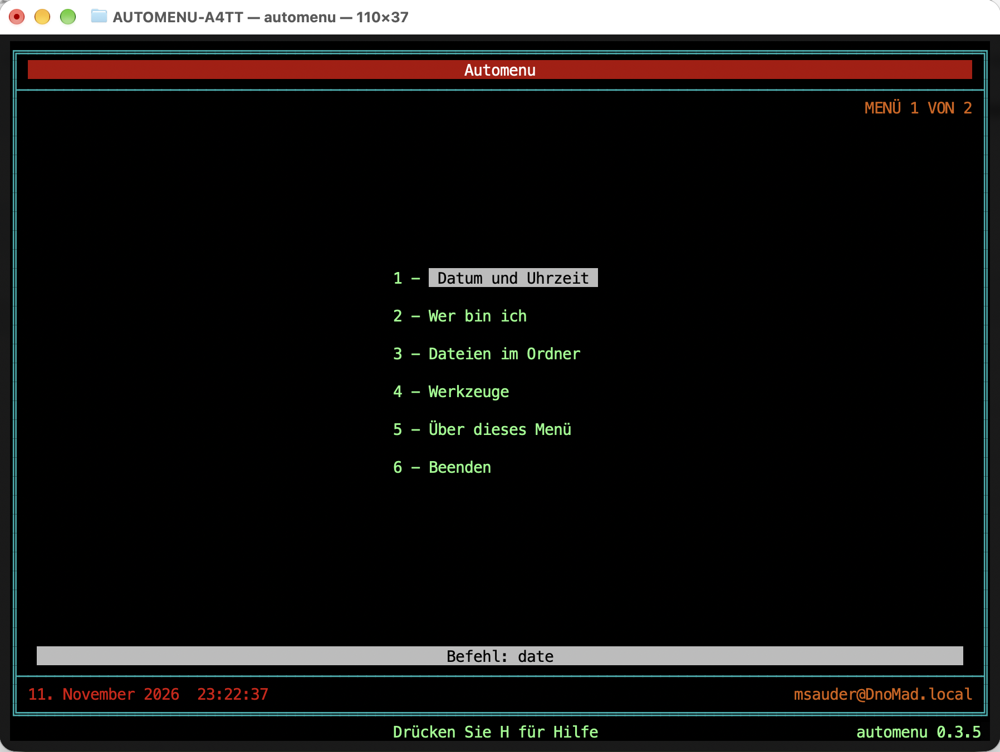
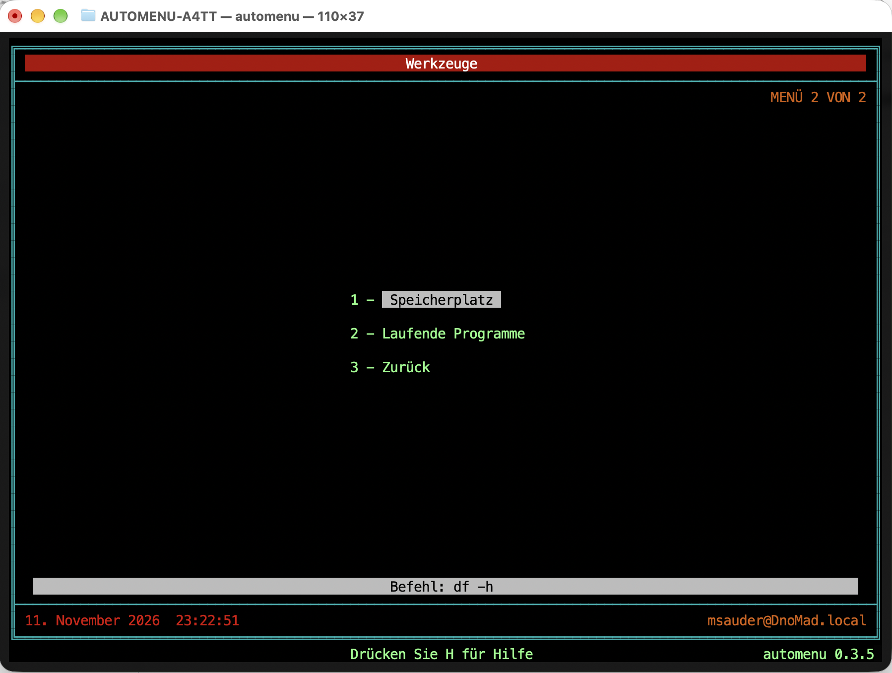
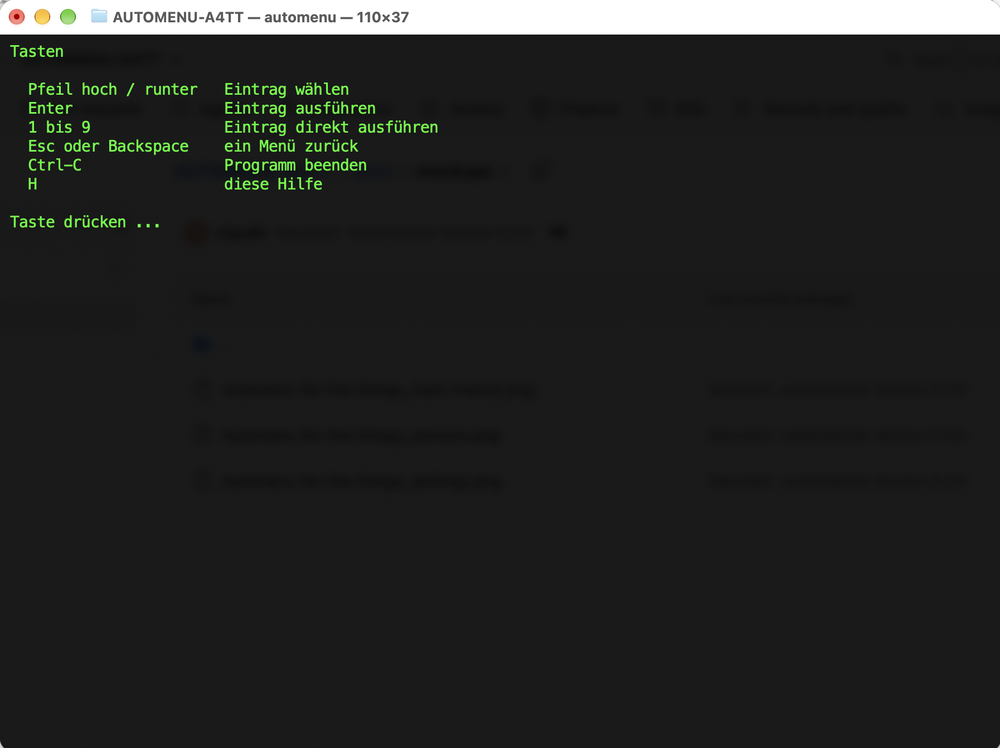

# Automenu

A text menu like in the old days of CP/M and MS-DOS. You write a plain text file,
the program turns it into a menu, and a key press starts a command.

Targets, in this order: MacBook (Terminal), Linux distributions, FreeBSD, then ESP32 and other Things.

| Platform | Status |
|---|---|
| Linux | built and tested |
| macOS | built and tested on macOS Golden Gate 27.2 (Terminal, Apple Silicon), see COOKBOOK.md |
| FreeBSD | plain C and POSIX only, not tested there yet |
| ESP32 | planned (1.1.0) |

## Getting started

    make
    ./automenu examples/menu.mdf

Use: arrow keys and Enter, digits 1 to 9 for direct access, Esc goes back, H shows the help.
The mouse works too: click runs an item, the wheel selects.

Also try `./automenu examples/things.mdf`.

## What it looks like

macOS Terminal, font Menlo, `AUTOMENU_FRAME=lines`.

## Installing

| System | Command |
|---|---|
| Linux, macOS | `sudo make install` (to `/usr/local`) |
| without admin rights | `make install PREFIX=$HOME/.local` |
| FreeBSD | port or package, see `packaging/freebsd/README.txt` |
| macOS step by step | COOKBOOK.md, section 2 |

Then put your menu at `~/.config/automenu/menu.mdf`, and `automenu` starts without arguments.
All paths are listed in the cookbook under "Where things live".

## Building your own menu

See **COOKBOOK.md**. One menu entry is one line:

    menu start "My menu"
      item "Show the date"   run date
      item "Quit"            exit

## Structure

| File | Purpose |
|---|---|
| `src/menu.h` | data model |
| `src/core.c` | menu logic, no IO, reusable on the ESP32 later |
| `src/loader.c` | reads and checks the menu file (`.mdf`) |
| `src/auth.c` | password hash (PBKDF2-SHA256), no dependencies |
| `src/terminal.c` | keys, mouse, screen, running commands (macOS, Linux, FreeBSD) |
| `tests/test_all.c` | tests (`make test`) |
| `Makefile` | build, test, install |
| `man/automenu.1` | man page |
| `packaging/freebsd/` | port skeleton |
| `examples/` | example menus |

For the ESP32 only `terminal.c` will be replaced. Core and loader stay.

## Roadmap

| Version | Content | Status |
|---|---|---|
| 0.2 | menus, submenus, running commands, info texts, check mode | done |
| 0.2.1 | installation: Makefile, fixed paths, man page, port skeleton | done, port untested |
| 0.3.0 | look of the Auto-Menu programs: frame, colours, description bar, clock, help | done |
| 0.3.1 | frame fills the window and adapts at once, fixed 256 colour palette | done |
| 0.3.2 | colour detection also with TERM=vt100, switches for colours and frame | done |
| 0.3.3 | compact items with one blank row between them | done |
| 0.3.4 | version number at the edge, items roughly centred again | done |
| 0.3.5 | frame made of coloured areas by default, works with any font | done |
| 0.9.0 | menu definition file `.mdf`, password lock per item, mouse, UTC clock, blackout | done, untested on FreeBSD |
| 0.9.1 | start option `--kiosk` instead of a separate kiosk build | done |
| 0.9.2 | English as the only language (screen texts, messages, documentation) | done |
| 1.0.0 | after the FreeBSD test and a few days of daily use | open |
| 1.1.0 | ESP32 adapter (serial console) | open |

## Rules to keep the project small

1. Exactly one new thing per version.
2. Code with a test first, then at most 3 lines of documentation.
3. Documentation lives only in `README.md` and `COOKBOOK.md`.
4. Old drafts live only in the git history (state 0.1.0) and are no longer maintained.

## Password lock and kiosk: what they can do

Single menu items can be locked with `lock` (create the hash with `automenu --hash`), and `automenu --kiosk` disables Ctrl-C. This is a lock against the curious and against mistakes, not a security feature. Details in the cookbook, section 3.

## Origin and licence

The idea comes from Automenu by Marshall W. Magee (Magee Enterprises, from 1983, DOS only, no longer available). This project is an independent new implementation without any code of the original and has no connection to Magee Enterprises. Open source under the BSD 2-Clause licence, Copyright (c) 2026, FerienBSD aka Marcel Sauder.
