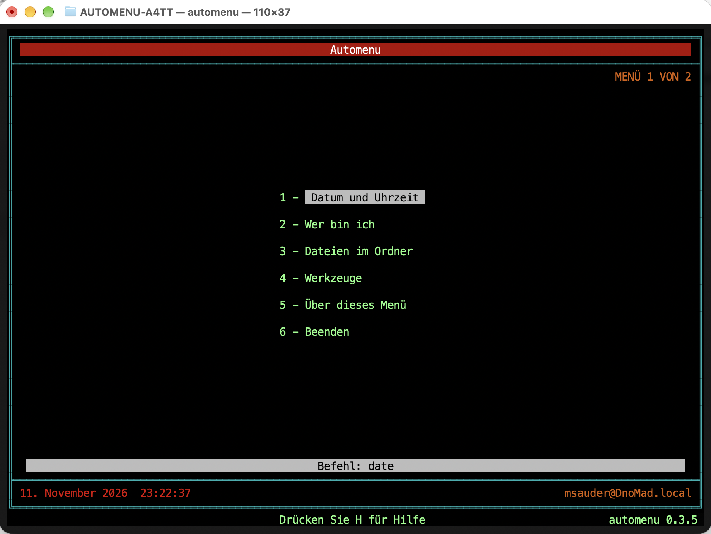

# Automenu

Ein Textmenü wie damals unter CP/M und MS-DOS. Du schreibst eine Textdatei,
das Programm zeigt daraus ein Menü, und ein Tastendruck startet einen Befehl.

Ziele in dieser Reihenfolge: MacBook (Terminal), Linux-Distributionen, FreeBSD, danach ESP32 und weitere Things.

| Plattform | Stand |
|---|---|
| Linux | gebaut und getestet |
| macOS | gebaut und getestet auf macOS Golden Gate 27.2 (Terminal, Apple Silicon), siehe COOKBOOK.md |
| FreeBSD | nur Standard-C und POSIX, noch nicht dort getestet |
| ESP32 | geplant (0.4) |

## Starten

    make
    ./automenu examples/menu.mdf

Bedienung: Pfeiltasten und Enter, Ziffern 1 bis 9 direkt, Esc geht zurück, H zeigt die Hilfe.

Probiere auch `./automenu examples/things.mdf`.

## So sieht es aus

Terminal von macOS, Schrift Menlo, `AUTOMENU_FRAME=lines`.

## Installieren

| System | Befehl |
|---|---|
| Linux, macOS | `sudo make install` (nach `/usr/local`) |
| ohne Admin-Rechte | `make install PREFIX=$HOME/.local` |
| FreeBSD | Port oder Package, siehe `packaging/freebsd/README.txt` |
| macOS Schritt für Schritt | COOKBOOK.md, Abschnitt 2 |

Danach: Menü nach `~/.config/automenu/menu.mdf` legen, dann startet `automenu` ohne Argument.
Alle Pfade stehen im Cookbook unter "Wo liegt was".

## Menü selbst bauen

Siehe **COOKBOOK.md**. Ein Eintrag besteht aus einer Zeile:

    menu start "Mein Menü"
      item "Datum anzeigen"   run date
      item "Beenden"          exit

## Aufbau

| Datei | Aufgabe |
|---|---|
| `src/menu.h` | Datenmodell |
| `src/core.c` | Menülogik, kein IO, später auch auf dem ESP32 nutzbar |
| `src/loader.c` | liest und prüft die Menüdatei (`.mdf`) |
| `src/auth.c` | Passwort-Hash (PBKDF2-SHA256), ohne Abhängigkeiten |
| `src/terminal.c` | Tasten, Bildschirm, Befehle ausführen (nur Mac/Linux) |
| `tests/test_all.c` | Tests (`make test`) |
| `Makefile` | bauen, testen, installieren |
| `man/automenu.1` | Man-Page |
| `packaging/freebsd/` | Port-Gerüst |
| `examples/` | Beispielmenüs |

Für den ESP32 wird später nur `terminal.c` ersetzt. Kern und Loader bleiben.

## Fahrplan

| Version | Inhalt | Stand |
|---|---|---|
| 0.2 | Menüs, Untermenüs, Befehle ausführen, Info-Texte, Prüfmodus | fertig |
| 0.2.1 | Installation: Makefile, feste Pfade, Man-Page, Port-Gerüst | fertig, Port ungetestet |
| 0.3.0 | Darstellung im Stil der Auto-Menu-Programme: Rahmen, Farben, Beschreibungsleiste, Uhr, Hilfe | fertig |
| 0.3.1 | Rahmen füllt das Fenster und passt sich sofort an, feste 256-Farben-Palette | fertig |
| 0.3.2 | Farberkennung auch bei TERM=vt100, Umschalter für Farben und Rahmen | fertig |
| 0.3.3 | Einträge kompakt, mit einer Leerzeile dazwischen | fertig |
| 0.3.4 | Versionsnummer am Rand, Einträge wieder ungefähr mittig | fertig |
| 0.3.5 | Rahmen aus Farbflächen als Standard, funktioniert mit jeder Schrift | fertig |
| 0.9.0 | Menüdefinitionsdatei `.mdf`, Passwortschutz pro Eintrag, Maus, UTC-Uhr, Blackout | fertig, ungetestet auf FreeBSD |
| 0.9.1 | Startparameter `--kiosk` statt eigener Kiosk-Version | fertig |
| 1.0.0 | nach FreeBSD-Test und einigen Tagen Alltagsbetrieb | offen |
| 1.1.0 | ESP32-Adapter (serielle Konsole) | offen |

## Regeln, damit das Projekt klein bleibt

1. Pro Version genau 1 neue Sache.
2. Erst Code mit Test, dann höchstens 3 Zeilen Doku.
3. Doku gibt es nur in `README.md` und `COOKBOOK.md`.
4. Alte Entwürfe stehen nur noch in der Git-Historie (Stand 0.1.0) und werden nicht weitergepflegt.

## Herkunft und Lizenz

Die Idee stammt von Automenu von Marshall W. Magee (Magee Enterprises, ab 1983, nur für DOS, heute nicht mehr erhältlich). Dieses Projekt ist eine unabhängige Neuentwicklung ohne Code des Originals und steht in keiner Verbindung zu Magee Enterprises. Open Source unter der BSD-2-Clause-Lizenz, Copyright (c) 2026, FerienBSD aka Marcel Sauder.
